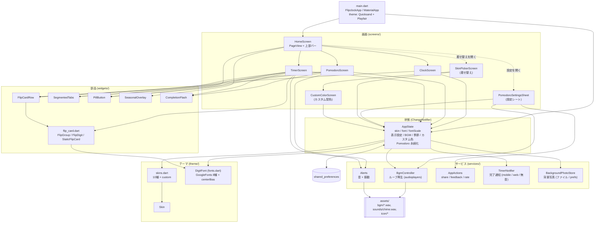
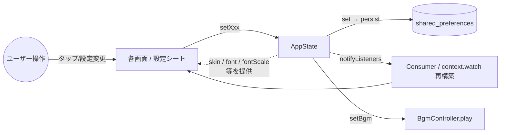
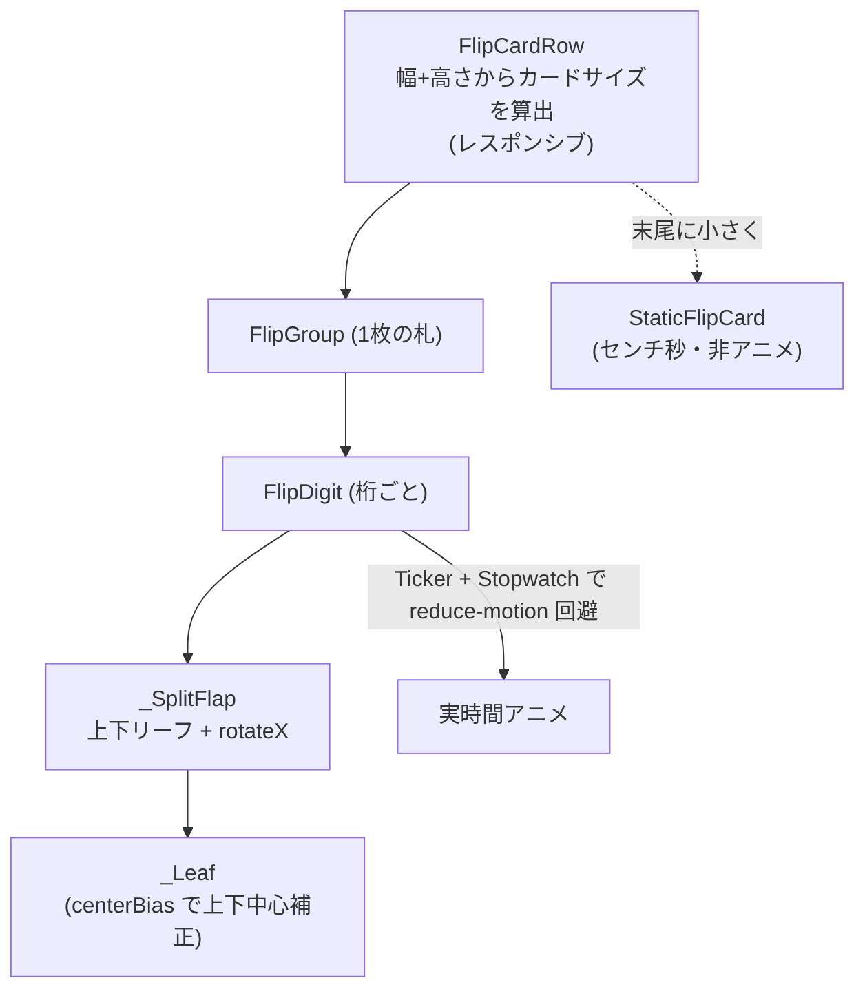
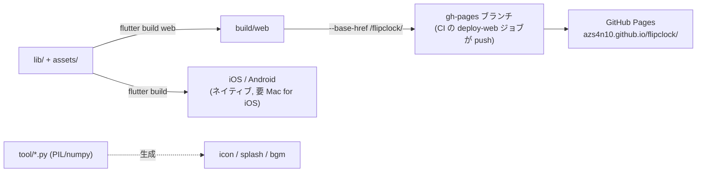

# flipclock アーキテクチャ

ゆめかわ系フリップ時計アプリ（Clock / Pomodoro / Timer + 着せ替え）。
Flutter（web / iOS / Android）製。状態管理は `provider`、永続化は
`shared_preferences`。

## レイヤー構成と依存

## 状態とデータの流れ

- 設定はすべて `AppState` の `setXxx()` 経由で `shared_preferences` に保存され、
  `notifyListeners()` で全画面が再描画される。
- Pomodoro は終了時刻を絶対時刻で保存（`savePomodoro`）し、アプリを閉じても
  復元・経過反映できる。Timer も同じ考え方で、開始時刻・累積時間・モードを
  `TimerSnapshot` として保存する（`saveTimer` / `timerSnapshot`）。
- カウントダウンを始めると、終了時刻に合わせた完了通知を `TimerNotifier`
  経由で予約し、一時停止・リセット・モード変更で取り消す。実装は
  Android / iOS が `flutter_local_notifications`、web がブラウザの
  Notification API（タブが生きている間だけ）で、テストでは偽物に差し替える。
  通知の許可は最初にタイマーを開始したときに求める。
- 背景写真は Android / iOS ではアプリのドキュメントディレクトリのファイル、
  web では従来どおり `shared_preferences` に置く（`BackgroundPhotoStore`）。
  旧バージョンが設定に保存した写真は、初回起動時に一度だけファイルへ移す。
- 保存済みの BGM は起動時に再生を再開する。web は自動再生が止められるため、
  最初のタップまたはキー操作で再生を始める。

## フリップ描画の構造

## 外部パッケージ

| 用途 | パッケージ |
|---|---|
| 状態管理 | provider |
| 永続化 | shared_preferences |
| フォント | google_fonts |
| 音 / BGM | audioplayers |
| 日付整形 | intl |
| 共有 | share_plus |
| メール/URL | url_launcher |
| レビュー | in_app_review |
| 配色ピッカー | flutter_colorpicker |
| 完了通知 | flutter_local_notifications, timezone |
| 背景写真の保存先 | path_provider |
| 背景写真の選択・縮小 | image_picker, image |
| 画面の常時点灯 | wakelock_plus |
| ブラウザ API (通知) | web |
| アイコン生成(dev) | flutter_launcher_icons |
| 起動画面生成(dev) | flutter_native_splash |

## ビルド & デプロイ

- web は `main` への push のたびに `.github/workflows/ci.yml` が解析・テスト・
  ビルドを行い、通ったビルドだけを `deploy-web` ジョブが `gh-pages` ブランチへ
  コミットする。Pages の配信元は従来どおり `gh-pages` ブランチのままで、
  リポジトリ設定の変更は要らない。
- Actions が使えないときは、同じビルド（`build/web` と空の `.nojekyll`）を
  `gh-pages` へ手で push すれば同じ結果になる。
- アイコン・起動画面・BGM 音源は `tool/` の Python スクリプトで生成。
